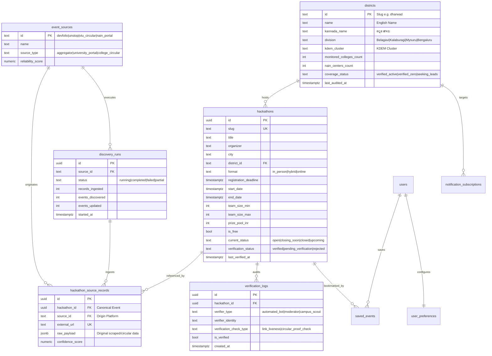

# HackMitra Supabase PostgreSQL Backend Architecture & Setup Guide

This document provides complete instructions for provisioning, configuring, and maintaining the Supabase PostgreSQL database for **HackMitra**.

---

## 1. Schema Architecture Overview

The HackMitra database architecture is organized into **6 core tables** for event discovery, source attribution, and verification tracking, plus **3 tables** prepared for future user personalization and alert notifications:



---

## 2. Migration Files

Migrations are stored in [`supabase/migrations/`](file:///c:/Users/Lenovo/HackMitra/supabase/migrations):

1. **`001_create_districts_table.sql`**: Initial districts schema with divisions and check constraints.
2. **`002_seed_districts.sql`**: Complete, accurate seed of all 31 Karnataka districts with official headquarters, Kannada names, monitored college counts, and NAIN centers.
3. **`003_create_backend_schema.sql`**: Full production schema for `hackathons`, `event_sources`, `hackathon_source_records`, `verification_logs`, `discovery_runs`, `saved_events`, `user_preferences`, and `notification_subscriptions`. Includes Row Level Security (RLS) policies and integrity triggers.
4. **`004_seed_sources_and_initial_data.sql`**: Seeds official verification sources (Devfolio, Unstop, VTU Registrar, K-Tech NAIN, KDEM) without any invented production events.

---

## 3. Environment Variables Configuration

Create a `.env.local` file based on [`.env.example`](file:///c:/Users/Lenovo/HackMitra/.env.example):

```bash
cp .env.example .env.local
```

| Variable | Scope | Description |
| :--- | :--- | :--- |
| `NEXT_PUBLIC_SUPABASE_URL` | Public (Browser + Server) | Your Supabase project URL (`https://<project-ref>.supabase.co`) |
| `NEXT_PUBLIC_SUPABASE_ANON_KEY` | Public (Browser + Server) | Anon public key. Safe in frontend bundles; scoped strictly by RLS. |
| `SUPABASE_SERVICE_ROLE_KEY` | **Private (Server Only)** | Service role key. Has bypass privileges. Used strictly by backend ingestion, scrapers, and bot verification workers. **Never prefix with `NEXT_PUBLIC_`**. |
| `NEXT_PUBLIC_APP_URL` | Public | Base URL (e.g. `http://localhost:3000` or production domain). |

---

## 4. Applying Migrations to Supabase

### Option A: Using the Supabase CLI (Recommended)

1. Authenticate with your Supabase account:
   ```bash
   npx supabase login
   ```
2. Link your local repository to your remote Supabase project:
   ```bash
   npx supabase link --project-ref <your-project-ref>
   ```
3. Push all migrations:
   ```bash
   npx supabase db push
   ```

### Option B: Using the Supabase Dashboard SQL Editor

1. Open your project on [database.new](https://database.new) or [supabase.com/dashboard](https://supabase.com/dashboard).
2. Go to **SQL Editor**.
3. Run the migrations in sequential order:
   - Paste and run [`supabase/migrations/001_create_districts_table.sql`](file:///c:/Users/Lenovo/HackMitra/supabase/migrations/001_create_districts_table.sql)
   - Paste and run [`supabase/migrations/002_seed_districts.sql`](file:///c:/Users/Lenovo/HackMitra/supabase/migrations/002_seed_districts.sql)
   - Paste and run [`supabase/migrations/003_create_backend_schema.sql`](file:///c:/Users/Lenovo/HackMitra/supabase/migrations/003_create_backend_schema.sql)
   - Paste and run [`supabase/migrations/004_seed_sources_and_initial_data.sql`](file:///c:/Users/Lenovo/HackMitra/supabase/migrations/004_seed_sources_and_initial_data.sql)

---

## 5. Security & Row Level Security (RLS) Matrix

| Table | Public Read | Public Insert/Update | Service Role |
| :--- | :---: | :---: | :---: |
| `districts` | Read-only | Blocked | Full Access |
| `event_sources` | Read active | Blocked | Full Access |
| `discovery_runs` | Read (Transparency) | Blocked | Full Access |
| `hackathons` | Read `verified` only | Blocked | Full Access |
| `hackathon_source_records` | Read (Proof) | Blocked | Full Access |
| `verification_logs` | Read (Audit trail) | Blocked | Full Access |
| `saved_events` | Own records only | Own records only | Full Access |
| `user_preferences` | Own records only | Own records only | Full Access |
| `notification_subscriptions` | Blocked | Insert permitted | Full Access |

---

## 6. Access Functions & Code Structure

- **Types**: [`src/types/database.types.ts`](file:///c:/Users/Lenovo/HackMitra/src/types/database.types.ts) — Full TypeScript types for all tables, columns, rows, inserts, updates, and enums.
- **Client Access**: [`src/lib/supabase/client.ts`](file:///c:/Users/Lenovo/HackMitra/src/lib/supabase/client.ts) — Browser client with RLS enforcement.
- **Server Access**: [`src/lib/supabase/server.ts`](file:///c:/Users/Lenovo/HackMitra/src/lib/supabase/server.ts) — Server Components and API Routes client.
- **Admin Access**: [`src/lib/supabase/admin.ts`](file:///c:/Users/Lenovo/HackMitra/src/lib/supabase/admin.ts) — Server-only client for background workers with guard against client bundling.
- **Service Layer**: [`src/lib/services/supabase-db.ts`](file:///c:/Users/Lenovo/HackMitra/src/lib/services/supabase-db.ts) — High-level database queries with automated fallback.
- **Automated Tests**: [`scripts/test-database-backend.ts`](file:///c:/Users/Lenovo/HackMitra/scripts/test-database-backend.ts) — Test script verifying schema types, client guards, and fallback behavior.
